# Zendesk Watcher: a short guide

Zendesk Watcher sits in the Windows tray and tells you when something in Zendesk needs you: a new ticket nobody has
taken, a reply on one of your tickets, or a customer waiting on a colleague's ticket while that colleague is off. You
don't need to keep Zendesk open to stay on top of things.

New here? Install it first with the [install guide](INSTALL.md). The pictures below use made-up sample data.

## Getting started

The first time it starts, the app walks you through three things: sign in, choose your groups, and pick how
notifications look.

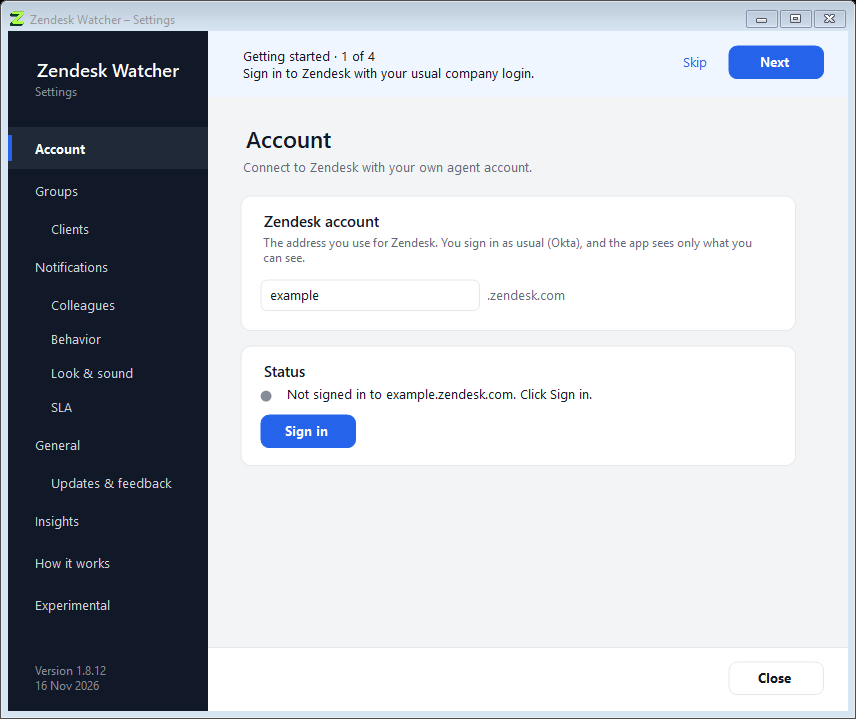

1. **Sign in** with your usual company login (Okta). The app sees only what you can see in Zendesk.
2. **Choose your groups**: the Zendesk groups whose new tickets you want to hear about.
3. **Done.** From then on the app checks Zendesk every few minutes and shows a notification when something needs you.
   Click the tray icon to open Settings any time.

## The notifications

### New ticket

A ticket landed in one of your groups and nobody has taken it yet. You see the client, the subject, who it's from and
how long ago, when the first reply is due, and the start of what they wrote. **Take it** assigns it to you and opens
it; the **▾** next to it suggests colleagues who could take it instead.

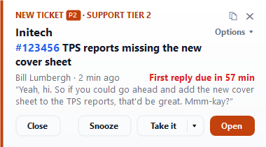

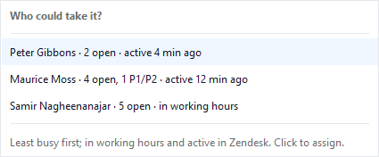

### Ticket updated

Someone else replied, added a note, or changed the status, priority or assignee of one of your tickets (or one you're
CC'd on or follow). The reply deadline shows at the right when a customer is waiting.

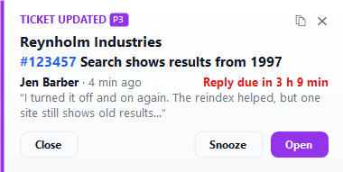

### Colleague's ticket

A customer wrote on a colleague's ticket while that colleague is off work or away, so you can step in.

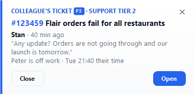

### Catch up

Your starting point for the day: what still needs you since you last worked, and your own tickets by status. It comes
when the app starts and when your working day starts, and any time from the tray menu or with **Ctrl+Alt+Z**.

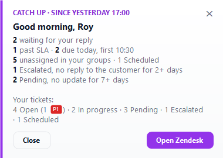

### Styles

Besides the classic list in the corner, notifications can wait as tabs at the screen edge (Peek), be summed up in a
small pill at the top, scroll by in a ticker, or pop up one at a time like a game achievement. Choose on
**Look & sound**.

| Pill | Ticker | Achievement |
|---|---|---|
| 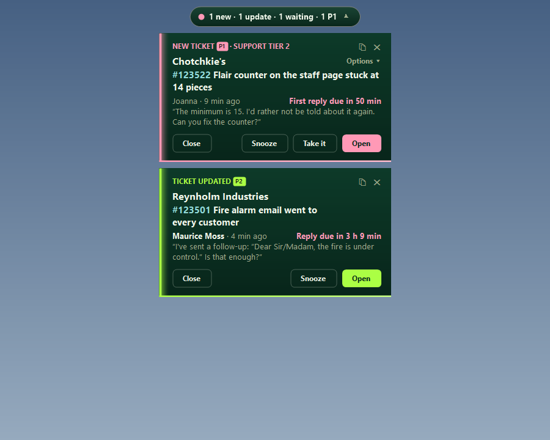 | 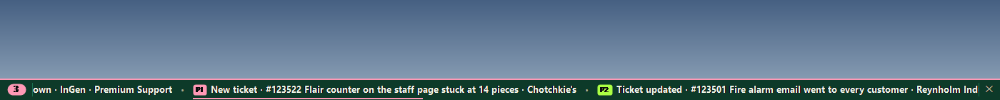 | 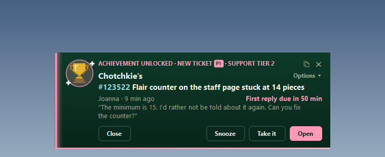 |

## The tray menu

Right-click the tray icon for Catch up, Check now, pausing notifications, Settings, updates and feedback. A left click
opens Settings.

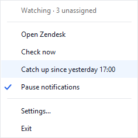

## Settings, page by page

Every page is also explained in the app, under **How it works**.

### Account

Connects the app to Zendesk with your own agent account. You sign in as usual (Okta), and the app sees only what you
can see in Zendesk.

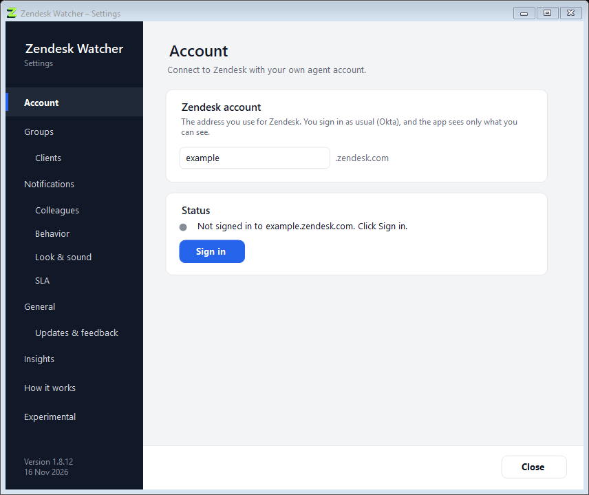

### Groups

Choose which Zendesk groups you watch for new work. Suggested groups are the ones you're a member of, or where your open
tickets are. Your own tickets notify you in any group.

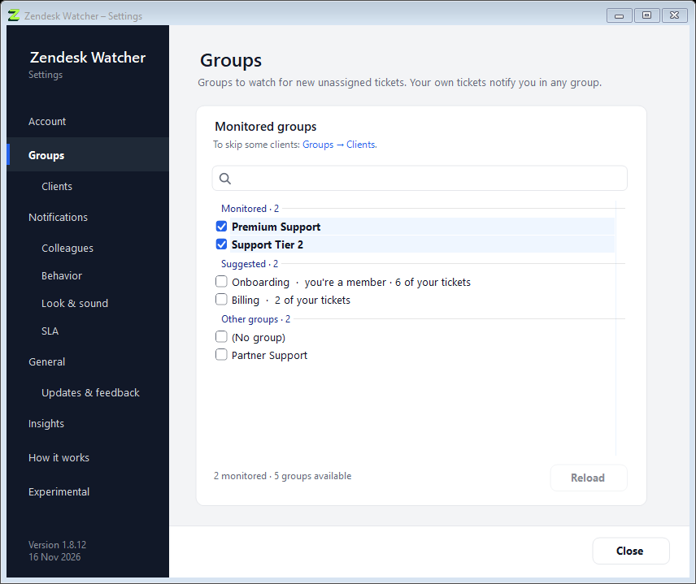

### Clients

Control which clients you get notifications from. You hear about every client in your groups to begin with. Untick a
client to mute it, or use **Options ▾** to make one Important (always notifies, stays until you close it), only urgent,
muted until your shift ends or your next shift, or give it its own sound.

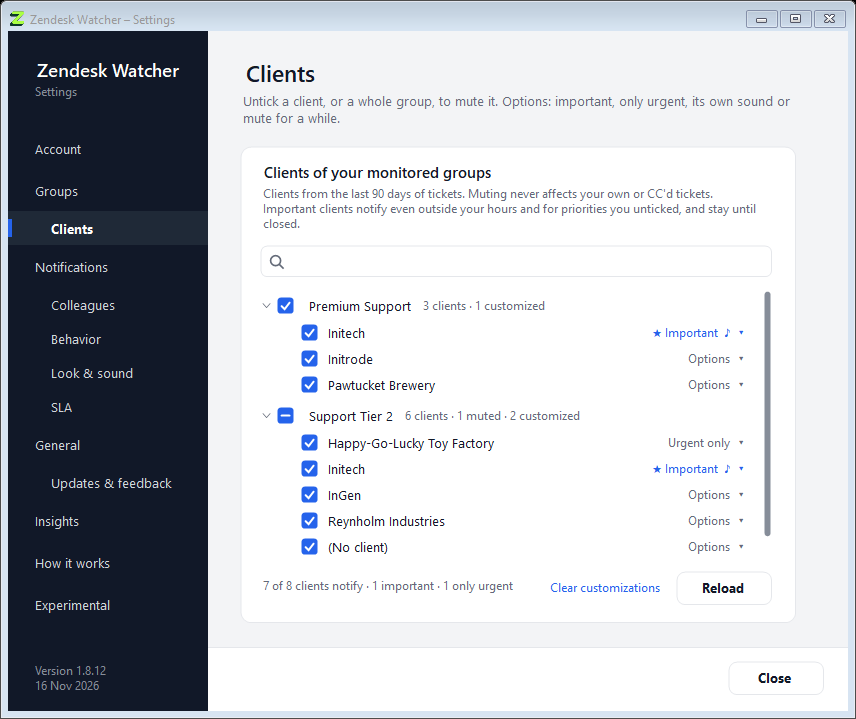

### Notifications

Choose what you want to hear about: new tickets in your groups, changes on your own tickets and the ones you're CC'd on
or follow, which kinds of change, and when you work. With "Only notify me during my working hours", notifications
outside them wait for Catch up, unless you're active in Zendesk.

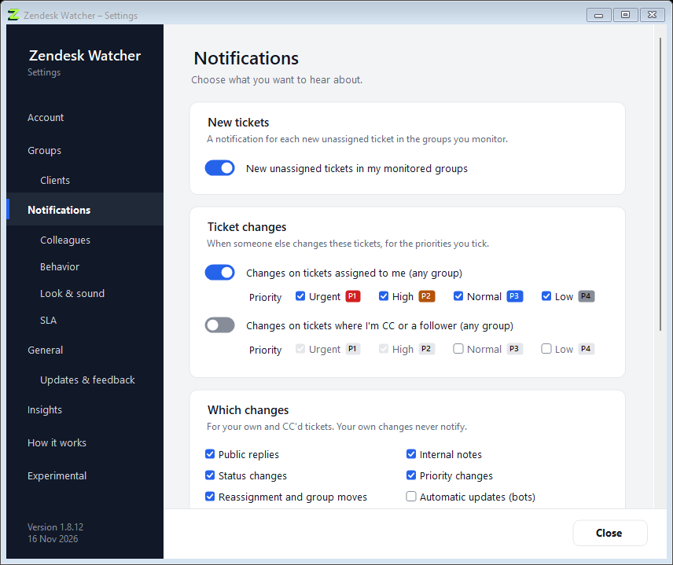

### Colleagues

Choose whose tickets you cover when a colleague is off, by region or one by one. Each colleague's local time shows
whether they're working now.

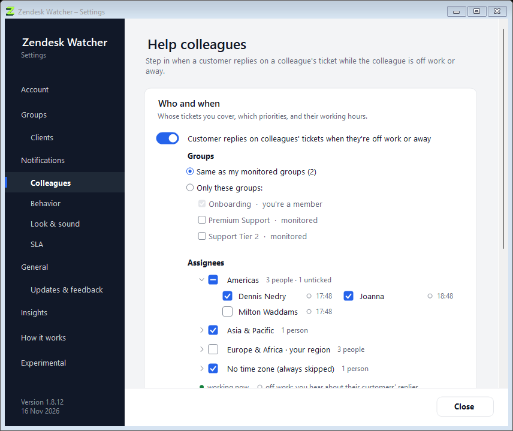

### Behavior

How long notifications stay, what happens to ones that waited while you were away, and Snooze.

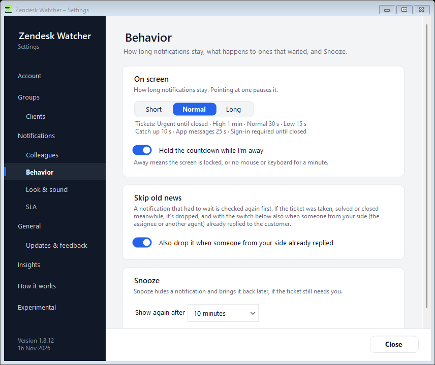

### Look & sound

The notification style, position and size, the glow at the screen edge for urgent tickets, a sound per kind of
notification, and the volume. **Try it** sends samples with your choices.

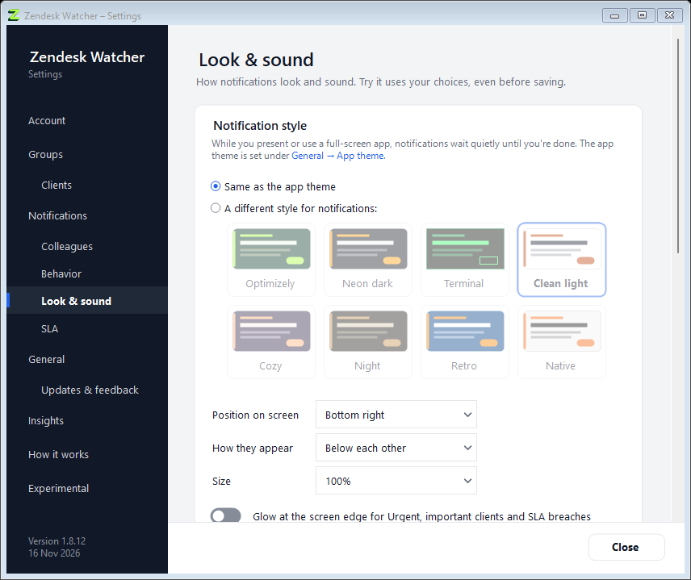

### SLA

How long until a reply is due, counting down in red on the notification. Zendesk's own SLA timer is used when the
ticket has one; otherwise the targets on this page.

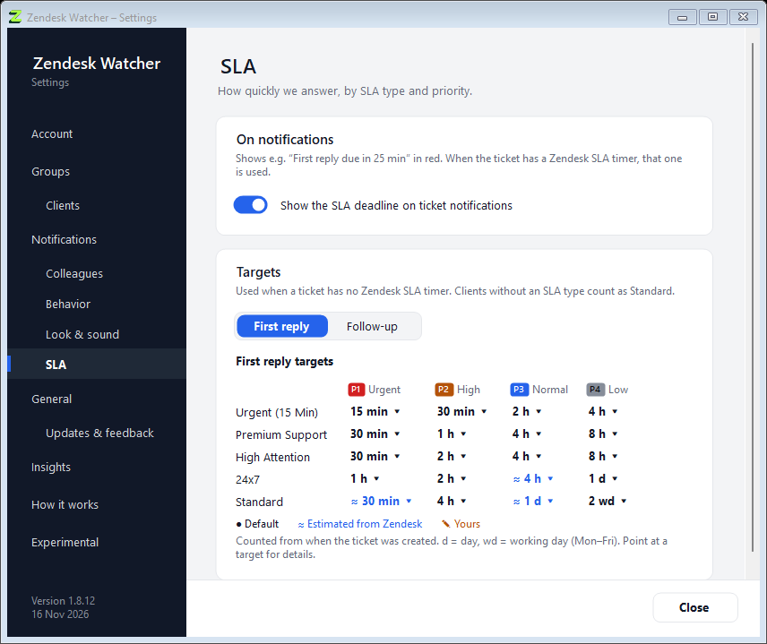

### General

The app's theme, and whether it starts with Windows and greets you with Catch up.

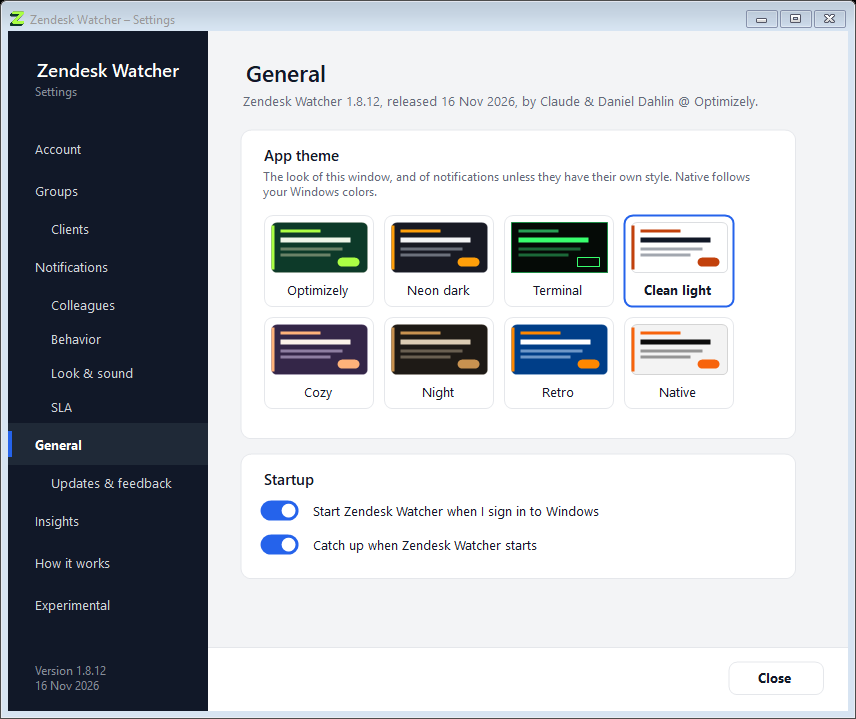

### Updates & feedback

New versions download by themselves and install when you restart the app. **Send feedback** emails the makers from your
own Outlook.

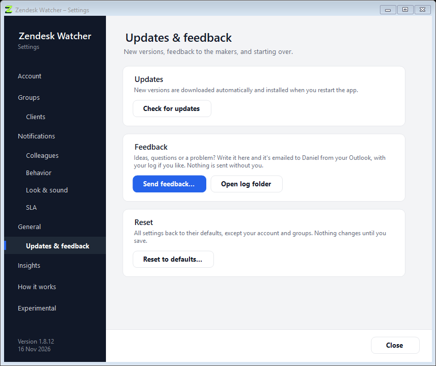

### Insights

What's waiting right now, how you used your notifications, tips to get fewer of the ones you never act on, and your
team's workload. Counted on your PC only.

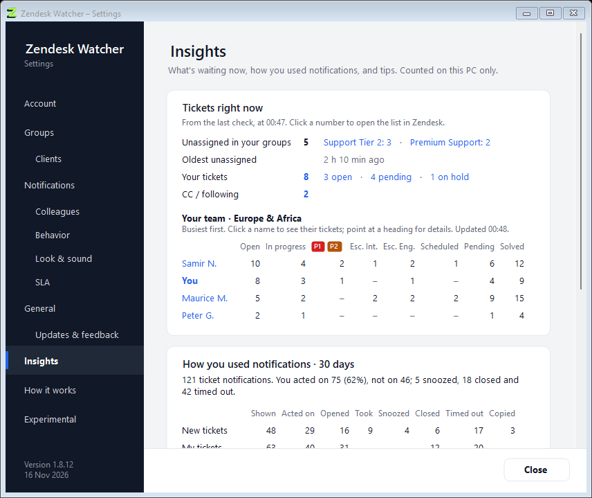

### Experimental

Two optional helpers that work entirely on your PC: a warning when a ticket sounds more urgent than its priority, and
quiet thank-yous. Both are off until you switch them on.

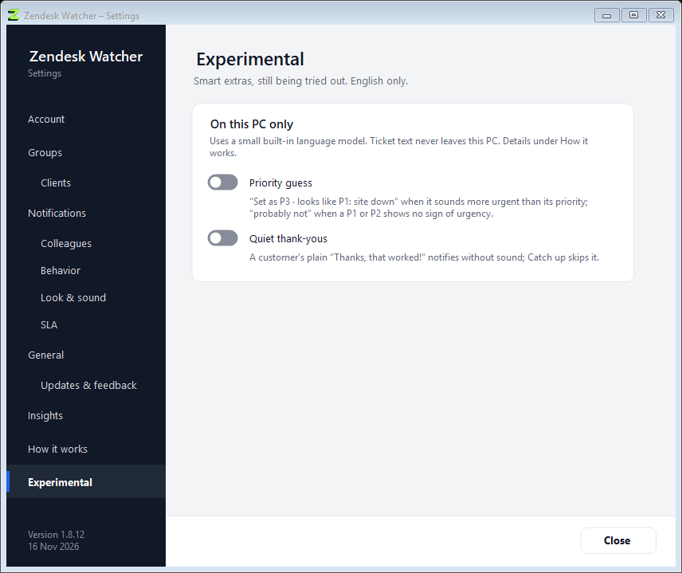

## Your data

The app reads Zendesk with your own sign-in and only changes something when you click Take it or assign a ticket to a
colleague. Nothing about your tickets is sent anywhere else. It checks every 3 minutes (every 10 while you're away), so
it adds little to your company's shared Zendesk limit.
